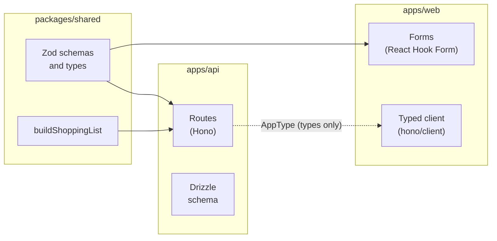
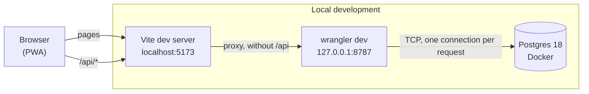
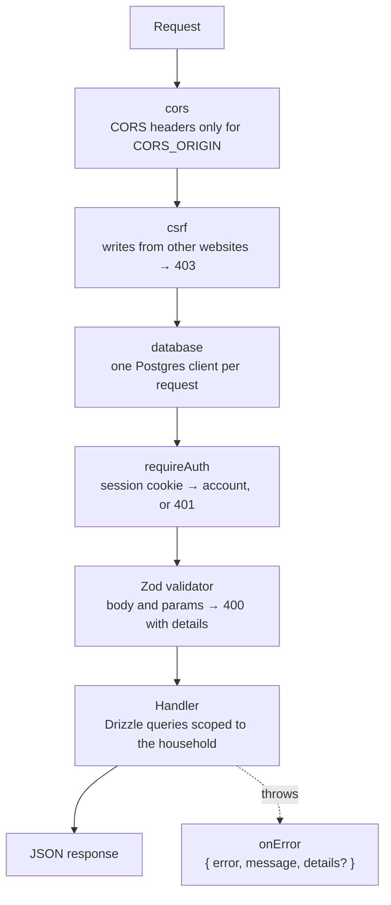
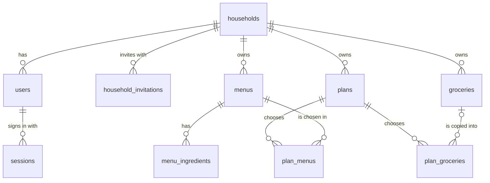

# Architecture

How MenuCart is built and why. The reasons behind each important choice are kept as short
[architecture decision records](adr/README.md) (ADRs).

## Overview

MenuCart is a pnpm monorepo with three packages:

| Package           | What it is                                         | Runs on                  |
| ----------------- | -------------------------------------------------- | ------------------------ |
| `apps/web`        | React PWA built with Vite                          | The browser              |
| `apps/api`        | REST API built with Hono, Drizzle ORM and Postgres | Cloudflare Workers       |
| `packages/shared` | Zod schemas, types and domain logic                | Both, imported as source |

`shared` is what keeps both sides in agreement: a menu, a grocery or a password is validated by the same
schema in the form and in the API, and the shopping list is built by the same function the API uses
(`buildShoppingList`). The web app also imports the **type** of the API (`AppType`) to call it with a typed
client, so a change in an endpoint that breaks the web app fails to compile
([ADR 0001](adr/0001-monorepo-with-a-shared-package.md), [ADR 0003](adr/0003-typed-api-client.md)).



## Runtime

The browser sees the web app and the API on **one origin**: the API lives under `/api`. That lets the
session cookie be `SameSite` and `HttpOnly`, with no tokens in JavaScript
([ADR 0006](adr/0006-cookie-sessions-on-one-origin.md)).



In production the same shape is kept: Cloudflare serves the web app and the Worker under one domain, and the
Worker reaches a managed Postgres. **The deployment is still being built** (steps 34 to 37 of the plan); this
section will be updated with its final shape and the database connection.

### Configuration

| Variable       | Where                     | Purpose                                                        |
| -------------- | ------------------------- | -------------------------------------------------------------- |
| `DATABASE_URL` | `apps/api/.dev.vars`      | Postgres connection string (a secret)                          |
| `CORS_ORIGIN`  | `apps/api/wrangler.jsonc` | Web app origins allowed to call the API, comma separated       |
| `VITE_API_URL` | `apps/web/.env.local`     | Base of every API call: `/api`, or a full URL. Checked by Vite |

## A request through the API

Every request goes through the same middlewares, in this order:



- **`cors`** answers with CORS headers only for the listed origins, so other websites cannot read responses.
- **`csrf`** refuses `POST`, `PUT` and `DELETE` whose `Origin` is not allowed, or that a browser marks as
  `Sec-Fetch-Site: cross-site`.
- **`database`** opens a client with a single connection and closes it after the response
  (`waitUntil`): Workers keep no process alive between requests.
- **`requireAuth`** (every route except `/health` and part of `/auth`) finds the session, extends it when it
  is close to expiring and puts the account, with its household, in the context.
- **Validation** uses the schemas of `shared`. Invalid data never reaches the handler.
- **Handlers** filter every query by the household of the account. An id of another household gives
  **404**, the same as one that does not exist ([ADR 0008](adr/0008-data-per-household.md)).
- **Errors** always have the same shape:

  ```json
  { "error": "validation_error", "message": "…", "details": [{ "path": "name", "message": "…" }] }
  ```

  Codes: `bad_request`, `validation_error`, `unauthorized`, `forbidden`, `not_found`, `conflict`,
  `too_many_requests` and `internal_error`. Unexpected errors are logged and never show their details.

### Endpoints

| Area          | Endpoints                                                                                            |
| ------------- | ---------------------------------------------------------------------------------------------------- |
| Health        | `GET /health` (database up or down)                                                                  |
| Auth          | `POST /auth/register`, `POST /auth/login`, `POST /auth/logout`, `GET /auth/me`, `PUT /auth/password` |
| Household     | `GET /households/current`, `POST /households/invitations`                                            |
| Menus         | `GET`, `POST /menus`; `GET`, `PUT`, `DELETE /menus/:id`                                              |
| Ingredients   | `GET /ingredients/suggestions?q=` (ignores accents)                                                  |
| Groceries     | `GET`, `POST /groceries`; `GET`, `PUT`, `DELETE /groceries/:id`                                      |
| Plans         | `GET /plans` (history), `GET /plans/current`, `GET /plans/suggestion`, `POST /plans`                 |
|               | `GET`, `PUT`, `DELETE /plans/:id`; `PUT`, `DELETE /plans/:id/menus/:menuId` (×N)                     |
|               | `PUT`, `DELETE /plans/:id/groceries/:groceryId` (with quantity)                                      |
| Shopping list | `GET /plans/:id/shopping-list`                                                                       |

## Data model



- **Households** own everything: menus, groceries and plans have a `household_id`, and people join a
  household with a one-time invitation code.
- **Plans** ("quincenas") cover any 1 to 31 days, and two plans of a household cannot share a day. Postgres
  enforces it with an exclusion constraint ([ADR 0004](adr/0004-free-plan-dates-without-overlaps.md)).
- **`plan_menus`** stores how many times a menu is planned (`times`). A menu used in a plan cannot be deleted
  (`ON DELETE RESTRICT`); it is archived instead ([ADR 0005](adr/0005-archive-menus-used-in-plans.md)).
- **`plan_groceries`** copies the grocery when it is chosen, so editing or deleting it later never changes a
  plan already made.
- **`sessions`** and **`household_invitations`** keep only SHA-256 hashes, never the tokens or codes.
- **`failed_attempts`** counts recent failures of logins, invitation codes and password changes
  ([ADR 0007](adr/0007-password-hashing-and-attempt-limits.md)).

The schema is defined in [`apps/api/src/db/schema.ts`](../apps/api/src/db/schema.ts). Every change becomes a
versioned SQL migration in [`apps/api/drizzle/`](../apps/api/drizzle), reviewed and, when the schema builder
cannot express a rule (exclusion constraints, filling a new column), edited by hand.

## Web app

- **Structure:** `pages/` holds one component per route, and `features/<area>/` holds the components and the
  queries of each area (menus, groceries, plans, shopping list, auth, household).
- **Server state** lives in TanStack Query. Building a plan uses **optimistic updates**: the screen changes at
  once and goes back if the API refuses it. Errors 4xx are not retried, and any 401 signs the user out.
- **Forms** use React Hook Form with the Zod schemas of `shared`, so the browser shows the same rules as the
  API before sending anything.
- **Routes:** `RequireAccount` sends visitors to `/login` and brings them back afterwards (only to paths of
  the app); `/login` and `/register` send signed-in users to the app.
- **Languages:** Spanish and English with i18next. Translation keys are typed, so a missing key fails to
  compile.
- **Design:** "delivery app" structure with an editorial look: cream background, Fraunces for titles and Plus
  Jakarta Sans for text, with tokens in `src/index.css` ([ADR 0009](adr/0009-design-direction.md)).

## Testing

| Package  | Kind                                                                                       |
| -------- | ------------------------------------------------------------------------------------------ |
| `shared` | Unit tests of the schemas and of `buildShoppingList`                                       |
| `api`    | Integration tests: real HTTP requests to the app against a real Postgres (`menucart_test`) |
| `web`    | Component tests with Testing Library and a mocked API, through the real router             |

- API tests never mock the database: constraints, transactions and SQL injection attempts are tested
  against Postgres itself. The test database is created and migrated automatically.
- Important tests are checked with **mutation testing** by hand: the code is broken on purpose to confirm
  that some test fails.
- **CI** (GitHub Actions) runs formatting, lint (oxlint), typecheck, tests (with a Postgres service) and the
  build on every pull request.
